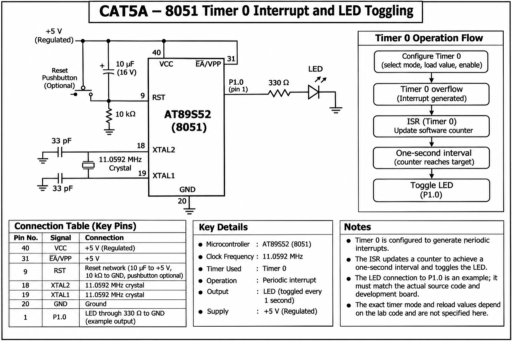

# CAT5A — Timer 0 Interrupt and Periodic LED Toggle

## EXP / DATE
CAT5 — 10/08/2026

## NAME OF EXP
Generate a periodic time base using the 8051 Timer 0 interrupt.

## HARDWARE SETUP / PLATFORM
AT89S52, 11.0592 MHz crystal, LED on P1.0, Keil C51, Timer 0 Mode 1 (16-bit).

## TASK NO
CAT5A — generate approximately 1 ms timer interrupts and toggle the LED after 1000 ticks.

## CIRCUIT DIAGRAM

## STEP-BY-STEP PROCEDURE
1. Open TASK5A.uvproj and inspect main.c.
2. Connect the LED to P1.0 with a current-limiting resistor if the board does not already include one.
3. Build the project and program the HEX file.
4. Reset the board and observe the LED.
5. Timer 0 is loaded with TH0=0xFC and TL0=0x66.
6. Each Timer 0 interrupt reloads the timer and increments ms_ticks.
7. When ms_ticks reaches 1000, the ISR clears the count and toggles the LED.
8. Record the observed period and compare it with the nominal timing.

## HOW THE CODE WORKS
TMOD selects Timer 0 Mode 1. ET0, EA and TR0 enable the timer interrupt and start the timer. The ISR is declared as interrupt 1. The foreground while loop is empty because the ISR performs the timing.

## EXPECTED OBSERVATION
P1.0 changes state after approximately 1000 timer ticks.

## TROUBLESHOOTING
Check the oscillator frequency, reload bytes, timer interrupt enables, LED wiring and programmed HEX file.

## INFERENCE
The task demonstrates interrupt-driven timing instead of software-delay timing.
