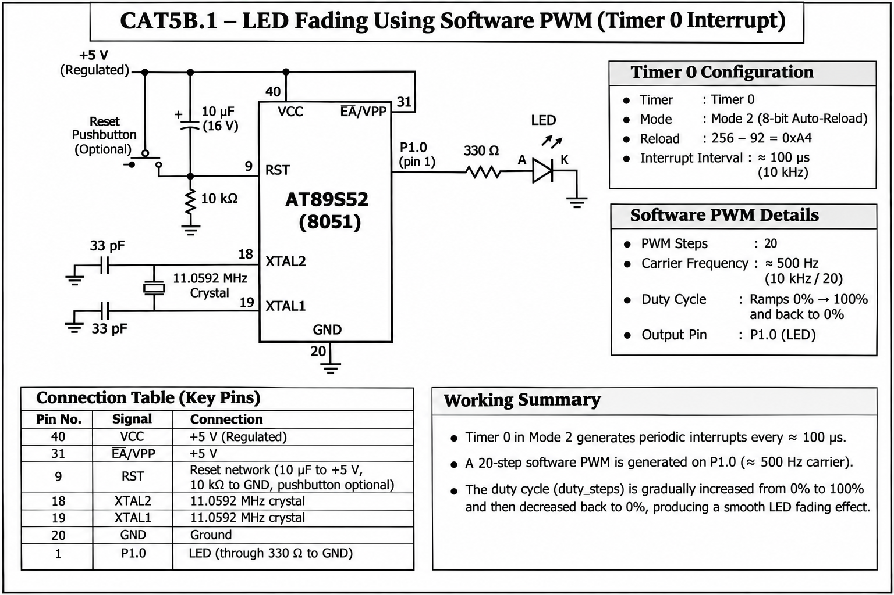

# CAT5B.1 — Software PWM LED Fading

## EXP / DATE
CAT5 — 10/08/2026

## NAME OF EXP
Generate software PWM with Timer 0 interrupts and sweep LED duty cycle.

## HARDWARE SETUP / PLATFORM
AT89S52, 11.0592 MHz crystal, LED on P1.0, Keil C51, Timer 0 Mode 2 auto-reload.

## TASK NO
CAT5B.1 — create a nominal 500 Hz PWM waveform and vary duty cycle from 0% to 100% and back.

## CIRCUIT DIAGRAM

## STEP-BY-STEP PROCEDURE
1. Open TASK5B_1.uvproj and main.c.
2. Connect the LED to P1.0 with suitable current limiting.
3. Build and program the HEX file.
4. Reset the MCU and observe LED brightness.
5. Timer 0 generates approximately 100 microsecond interrupts.
6. pwm_tick cycles through 20 slots. The output is HIGH while pwm_tick is less than duty_steps and LOW for the remaining slots.
7. duty_steps ranges from 0 to 20, giving 5% increments.
8. fade_counter advances in the ISR. Every 500 interrupts the duty cycle moves one step up or down.
9. Observe the brightness ramp and record whether the LED fades smoothly.

## HOW THE CODE WORKS
Twenty 100 microsecond slots form an approximately 2 ms PWM period. duty_steps controls the HIGH fraction. fade_up changes direction at the upper and lower limits. The main loop remains idle while the ISR updates the output.

## TROUBLESHOOTING
If the LED remains fully on/off, inspect duty_steps, P1.0 wiring and timer interrupts. If flicker is visible, check the oscillator and timer reload.

## INFERENCE
The task demonstrates PWM duty-cycle control and interrupt-driven brightness variation.
