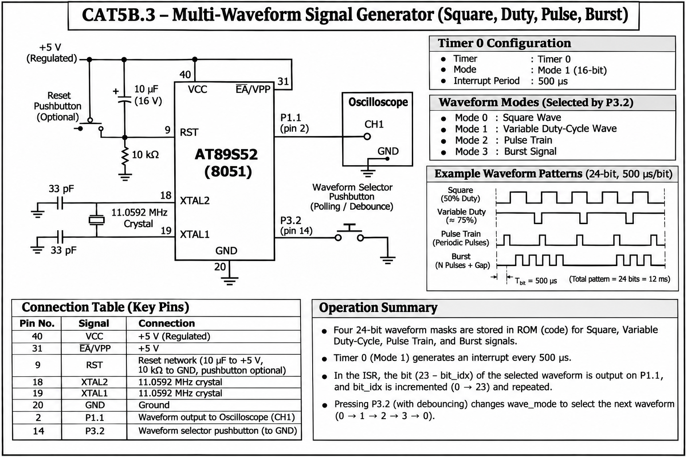

# CAT5B.3 — Selectable Digital Waveform Patterns

## EXP / DATE
CAT5 — 10/08/2026

## NAME OF EXP
Generate digital waveform patterns from a lookup table using Timer 0 interrupts.

## HARDWARE SETUP / PLATFORM
AT89S52, 11.0592 MHz crystal, output P1.1, active-low mode button P3.2, Keil C51, oscilloscope or logic analyzer.

## TASK NO
CAT5B.3 — cycle through four 24-bit waveform patterns.

## CIRCUIT DIAGRAM

## STEP-BY-STEP PROCEDURE
1. Open TASK5B_3.uvproj and inspect main.c.
2. Connect P1.1 to the oscilloscope input and join instrument and MCU grounds.
3. Connect the mode button to P3.2 as an active-low input.
4. Build and program the HEX file.
5. Reset the MCU and observe the first waveform.
6. Timer 0 updates the output bit at approximately 500 microsecond intervals.
7. Press and release the button to advance to the next pattern. bit_idx is reset to zero on each mode change.
8. Repeat until all four patterns have been captured.
9. Compare the captured output with the 24-bit values in waveforms[].

## WAVEFORM TABLE
- 0xAAAAAA: alternating HIGH/LOW bits.
- 0xF0F0F0: four HIGH slots followed by four LOW slots.
- 0x802008: sparse pulse sequence.
- 0xAA00AA: burst sequence with a middle LOW interval.

## HOW THE CODE WORKS
The ISR reloads Timer 0, selects one bit from the current 24-bit word, writes it to P1.1 and advances bit_idx modulo 24. The foreground loop debounces the button and advances wave_mode modulo four.

## TROUBLESHOOTING
Check the output pin, oscilloscope time scale, bit order, timer reload and mode button. Pattern repetition time is the slot duration multiplied by 24.

## INFERENCE
The task demonstrates lookup-table waveform synthesis using a timer-driven GPIO output.
