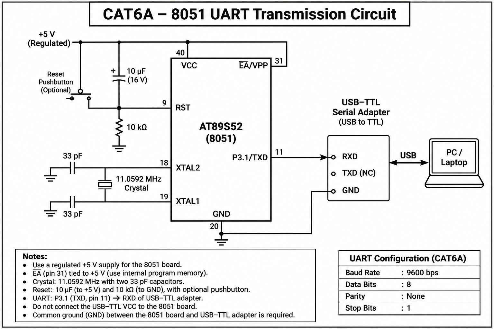

# CAT6A — UART Serial Transmission

## EXP / DATE
CAT6 — 17/08/2026

## NAME OF EXP
Transmit serial text from the AT89S52 using its UART.

## HARDWARE SETUP / PLATFORM
AT89S52, 11.0592 MHz crystal, USB-to-TTL adapter, PuTTY or another serial terminal, Keil C51. UART configuration: 9600 baud, 8 data bits, no parity, one stop bit.

## TASK NO
CAT6A — configure UART and repeatedly transmit a greeting message to the PC.

## CIRCUIT DIAGRAM

## STEP-BY-STEP PROCEDURE
1. Connect AT89S52 TXD P3.1 to adapter RXD.
2. Connect AT89S52 RXD P3.0 to adapter TXD.
3. Connect adapter GND to board GND. Use a logic-level-compatible USB-to-TTL adapter, not a direct RS-232 port.
4. Open TASK6A.uvproj and main.c in Keil.
5. Build and program the generated HEX file.
6. Open PuTTY, select the adapter COM port and configure 9600 baud, 8 data bits, no parity, one stop bit, no flow control.
7. Reset the 8051. Observe “Hello from 8051” printed repeatedly with CR/LF.
8. If output is garbled or absent, verify baud rate, oscillator, TX/RX crossover and common ground.

## HOW THE CODE WORKS
Timer 1 Mode 2 generates the baud clock. TH1=0xFD selects 9600 baud at 11.0592 MHz with SMOD=0. SCON=0x50 selects UART Mode 1 and enables reception. uart_tx_char() waits for TI; uart_tx_string() sends each character in turn.

## EXPECTED OBSERVATION
The terminal repeatedly displays the greeting message.

## INFERENCE
The task demonstrates asynchronous serial transmission from an 8051 to a PC terminal.
