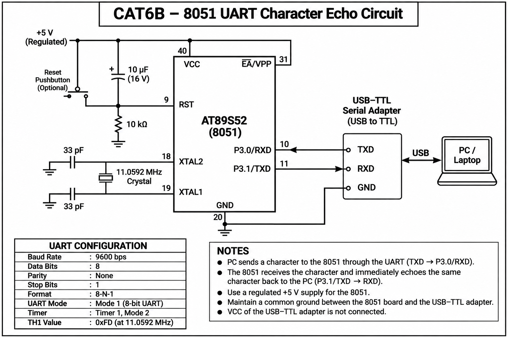

# CAT6B — Interrupt-Driven UART Receive and Echo

## EXP / DATE
CAT6 — 17/08/2026

## NAME OF EXP
Receive UART characters using a serial interrupt and ring buffer, then echo them.

## HARDWARE SETUP / PLATFORM
AT89S52, 11.0592 MHz crystal, USB-to-TTL adapter, PuTTY, Keil C51. UART is configured for 9600 baud, 8-N-1.

## TASK NO
CAT6B — accept characters from the PC and transmit each received character back.

## CIRCUIT DIAGRAM

## STEP-BY-STEP PROCEDURE
1. Connect P3.1/TXD to adapter RXD, P3.0/RXD to adapter TXD and GND to GND.
2. Check adapter logic voltage compatibility.
3. Open TASK6B.uvproj and main.c.
4. Build and program the HEX file.
5. Open the terminal at 9600 baud, 8-N-1, no flow control.
6. Reset the MCU and type a few characters.
7. The serial interrupt receives each byte and stores it in the ring buffer.
8. The foreground loop removes queued bytes and transmits them back.
9. Test short bursts first; the ring buffer has finite capacity.

## HOW THE CODE WORKS
uart_init() configures Timer 1 and enables the serial interrupt. uart_isr() reads SBUF when RI is set, clears RI and stores the byte if buffer space remains. rx_head is the producer index and rx_tail is the consumer index. TI completion clears tx_busy. The main loop echoes queued characters outside the receive ISR.

## TROUBLESHOOTING
Check crossed TX/RX wiring, common ground, baud rate and oscillator. Missing characters during long bursts may indicate ring-buffer overflow.

## INFERENCE
The task demonstrates interrupt-driven reception and producer-consumer buffering on an 8051.
