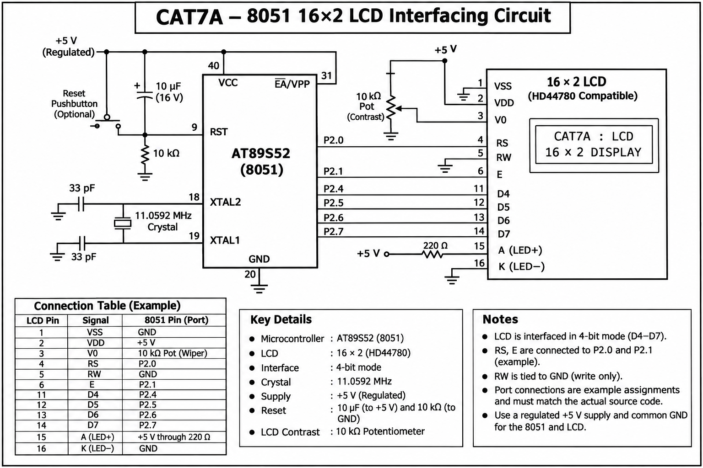

# CAT7A — 16×2 LCD Initialization and Text Display

## EXP / DATE
CAT7 — 24/08/2026

## NAME OF EXP
Interface an HD44780-compatible 16×2 LCD with the AT89S52 in 4-bit mode.

## HARDWARE SETUP / PLATFORM
AT89S52, 16×2 LCD, 4-bit interface, Keil C51, lcd.c and lcd.h driver files.

## TASK NO
CAT7A — initialize the LCD and display text on both rows.

## CIRCUIT DIAGRAM

## STEP-BY-STEP PROCEDURE
1. Open TASK7A.uvproj.
2. Inspect lcd.h and lcd.c to identify the actual RS, EN and data-pin assignments. Use these definitions as the wiring source of truth.
3. Connect LCD VSS to GND and VDD to the supported supply. Connect the contrast pin through a potentiometer.
4. Connect RS, EN and the four data lines exactly as defined in the driver. Tie R/W low if the driver uses write-only mode.
5. Ensure lcd.c and main.c are both included in the Keil project.
6. Build and program the HEX file.
7. Reset the board and adjust contrast until characters are visible.
8. Observe row 1: a character followed by “T89S52 4-Bit”.
9. Observe row 2: “16x2 LCD Ready!”.
10. If text is absent or shifted, recheck the pin map and initialization sequence.

## HOW THE CODE WORKS
lcd_init() initializes 4-bit mode. lcd_cmd() sends display commands, lcd_data() sends a character, and lcd_puts() sends a string. Command 0x80 selects the first row start; 0xC0 selects the second row start.

## TROUBLESHOOTING
Blank display: check power and contrast. Garbled text: check data-line order and initialization delays. No response: compare wiring with lcd.h.

## INFERENCE
This task demonstrates a reusable LCD driver and 4-bit parallel communication.
