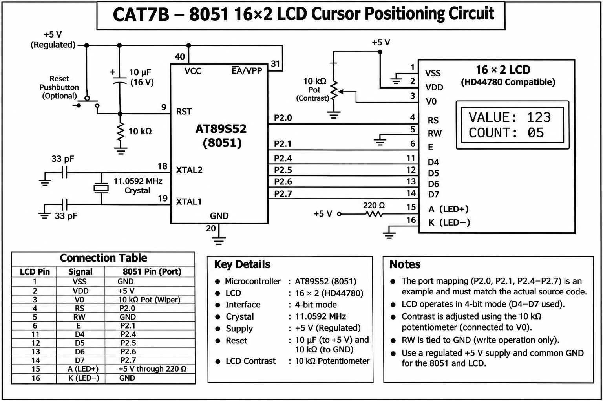

# CAT7B — LCD Cursor Positioning and Dynamic Counter

## EXP / DATE
CAT7 — 24/08/2026

## NAME OF EXP
Position the LCD cursor and display a changing numerical value.

## HARDWARE SETUP / PLATFORM
AT89S52, 16×2 HD44780-compatible LCD, 4-bit interface, Keil C51, lcd.c and lcd.h.

## TASK NO
CAT7B — display a heading and incrementing counter on the LCD.

## CIRCUIT DIAGRAM

## STEP-BY-STEP PROCEDURE
1. Open TASK7B.uvproj and inspect lcd.h for the LCD pin mapping.
2. Wire LCD power, ground, contrast, RS, EN and data lines to match lcd.c.
3. Build the project with main.c and lcd.c included.
4. Program the HEX file and reset the AT89S52.
5. Confirm the first row displays “AT89S52 Counter:”.
6. Confirm the second row displays “Value:” followed by a number.
7. Observe the value increment approximately every 500 ms.
8. Watch the display as the number gains digits; the trailing spaces in the source clear old characters.

## HOW THE CODE WORKS
lcd_goto(row,column) selects a cursor location. lcd_puts() writes labels. lcd_print_number() displays the unsigned integer. counter increments in the infinite loop and delay_500ms() controls the update interval.

## TROUBLESHOOTING
Check cursor row/column addressing, contrast, data wiring and lcd_print_number(). If old digits remain, inspect the spaces written after the value.

## INFERENCE
The task demonstrates cursor addressing and dynamic numerical output using an LCD library.
