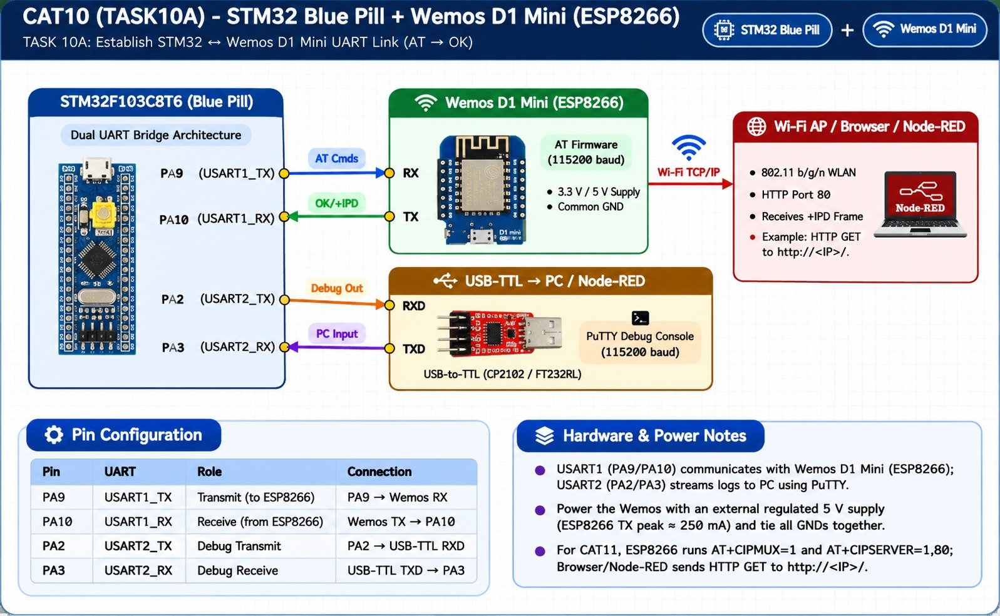

# CAT10 — Task 10A: STM32-to-ESP8266 UART Link

## EXP / DATE
CAT10 — 05/10/2026

## NAME OF EXP
Establish serial communication between STM32 and Wemos D1 Mini ESP8266.

## HARDWARE SETUP / PLATFORM
STM32F103C8T6 Blue Pill, Wemos D1 Mini ESP8266, STM32CubeMX, Keil MDK-ARM, PC terminal. USART1 is the ESP8266 link and USART2 is the PC logging link. Both are configured at 115200 baud, 8-N-1 in the source.

## TASK NO
Task 10A — send AT to the ESP8266 and forward its response to the PC terminal.

## CIRCUIT DIAGRAM

## STEP-BY-STEP PROCEDURE
1. Power the Wemos D1 Mini using its supported supply. The ESP8266 needs a stable supply with adequate current capacity.
2. Connect STM32 USART1 TX PA9 to Wemos RX and USART1 RX PA10 to Wemos TX.
3. Connect STM32 GND and Wemos GND together.
4. Connect the PC serial adapter to the USART2 pins configured by the project (PA2 TX and PA3 RX), and connect GND.
5. Open the task CubeMX/Keil project and confirm both UARTs are enabled at 115200 baud.
6. Build and flash the STM32.
7. Open the PC terminal on the USART2 adapter at 115200, 8-N-1.
8. Reset the board. The STM32 logs a header, sends AT plus CR/LF to the Wemos, receives a response and forwards the response to the PC.
9. Look for the ESP8266 response, normally OK when the modem is ready.
10. If no response appears, check Wemos power, TX/RX crossover, common ground, UART selection and AT firmware availability.

## HOW THE CODE WORKS
USART1 carries modem commands and responses. USART2 carries debug text to the PC. The firmware transmits AT through USART1, receives a response into a buffer, and forwards it through USART2.

## EXPECTED OBSERVATION
The PC terminal shows the STM32 message and the ESP8266 AT response.

## TROUBLESHOOTING
A missing response can indicate incorrect UART pins, baud mismatch, missing common ground, insufficient ESP8266 power or firmware without AT command support. Ensure received data is safely terminated before using string functions.

## INFERENCE
This task establishes the serial bridge required for later ESP8266 Wi-Fi commands.
