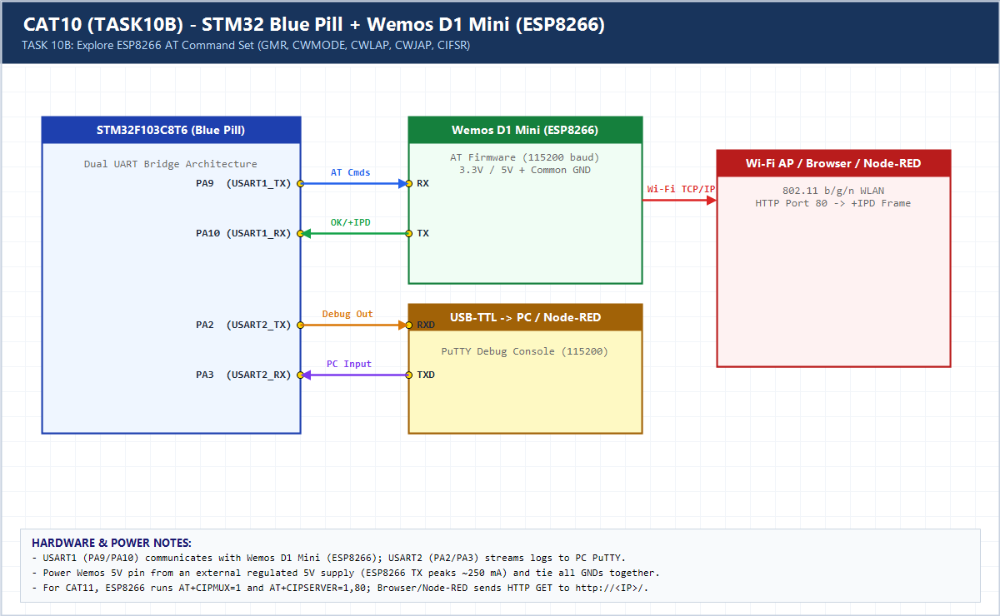

# CAT10 — Task 10B: Explore ESP8266 AT Commands

## EXP / DATE
CAT10 — 05/10/2026

## NAME OF EXP
Control and inspect ESP8266 Wi-Fi functionality using AT commands from STM32.

## HARDWARE SETUP / PLATFORM
STM32F103C8T6 Blue Pill, Wemos D1 Mini ESP8266, USART1 modem link, USART2 PC terminal, Keil MDK-ARM and STM32 HAL. Both UARTs are configured at 115200 baud, 8-N-1.

## TASK NO
Task 10B — issue basic modem commands and inspect their responses.

## CIRCUIT DIAGRAM

## STEP-BY-STEP PROCEDURE
1. Complete the Task 10A wiring: PA9 to Wemos RX, PA10 to Wemos TX and common GND. Connect the PC terminal to USART2.
2. Open the task project and inspect send_at_and_log() in main.c.
3. Build and flash the STM32.
4. Open the PC terminal at 115200 baud, 8-N-1 and reset the board.
5. The firmware sends AT. Check that the modem responds.
6. It sends AT+GMR to request firmware/version information.
7. It sends AT+CWMODE=1 to select station mode.
8. It sends AT+CWLAP to scan for visible access points. Allow the scan time for its longer response.
9. Read the response for each command in the PC terminal.
10. If AT does not respond, return to Task 10A wiring and UART checks before debugging later commands.

## COMMAND REFERENCE
- AT — check modem responsiveness.
- AT+GMR — request firmware/version information.
- AT+CWMODE=1 — select station mode.
- AT+CWLAP — scan available Wi-Fi access points.

## HOW THE CODE WORKS
send_at_and_log() transmits each command through USART1, waits for its response and logs the response through USART2. The calls run sequentially with command-specific timeouts.

## TROUBLESHOOTING
If AT fails, verify UART wiring and baud rate. If CWLAP finds no networks, check Wi-Fi availability, range and antenna. AT command behavior can vary by ESP8266 firmware version.

## INFERENCE
This task demonstrates command/response control of a Wi-Fi modem over UART.
