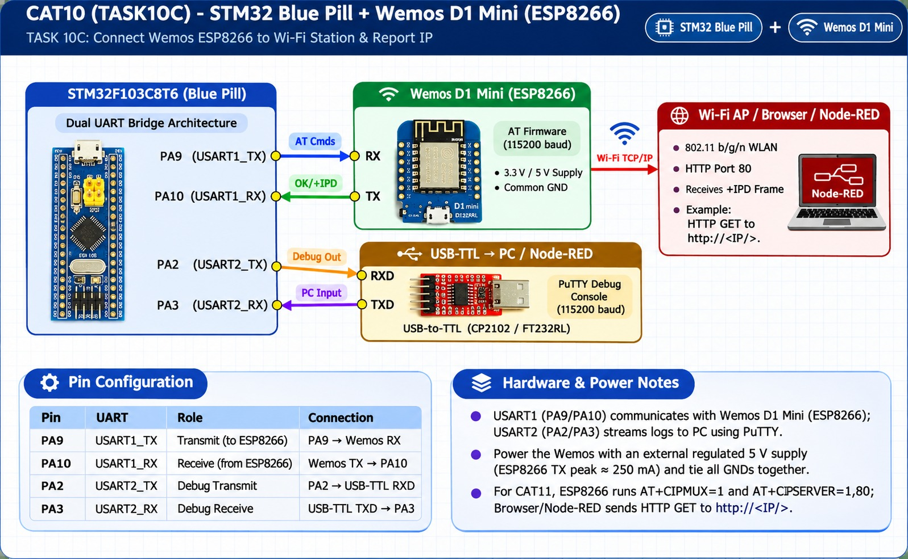

# CAT10 — Task 10C: Connect ESP8266 to Wi-Fi

## EXP / DATE
CAT10 — 05/10/2026

## NAME OF EXP
Configure ESP8266 station mode and join a wireless network using AT commands.

## HARDWARE SETUP / PLATFORM
STM32F103C8T6 Blue Pill, Wemos D1 Mini ESP8266, USART1 modem link, USART2 PC terminal, STM32 HAL and Keil MDK-ARM. UART is configured at 115200 baud, 8-N-1.

## TASK NO
Task 10C — join a Wi-Fi access point and query the assigned IP address.

## CIRCUIT DIAGRAM

## BEFORE RUNNING
The example source contains placeholder credentials MyWiFi and password. Replace them locally with the credentials for your test network before building. Do not commit real Wi-Fi passwords to a public repository.

## STEP-BY-STEP PROCEDURE
1. Wire USART1 between STM32 PA9/PA10 and Wemos RX/TX, crossing TX to RX. Connect common GND.
2. Connect the PC terminal through USART2.
3. Open main.c and replace the example SSID and password locally.
4. Build and flash the STM32 firmware.
5. Open the terminal at 115200 baud, 8-N-1.
6. Reset the board and observe the command sequence.
7. AT checks the modem; AT+CWMODE=1 selects station mode.
8. AT+CWJAP joins the configured access point. Allow time for association and authentication.
9. AT+CIFSR requests the interface address. Record the IP address returned by the ESP8266.
10. If connection fails, verify credentials, 2.4 GHz network availability, signal strength and ESP8266 supply stability.

## HOW THE CODE WORKS
esp_cmd() sends each AT command through USART1 and collects the modem response. log_pc() writes status text through USART2. The application performs station-mode setup, access-point association and IP query in sequence.

## EXPECTED OBSERVATION
The modem should report successful association and an assigned IP address when valid credentials and a compatible network are available.

## TROUBLESHOOTING
ESP8266 modules generally require a 2.4 GHz Wi-Fi network. Check SSID/password spelling, modem firmware, UART wiring and power. Keep credentials out of public source control.

## INFERENCE
This task demonstrates Wi-Fi network association and IP configuration through a serial AT-command interface.
