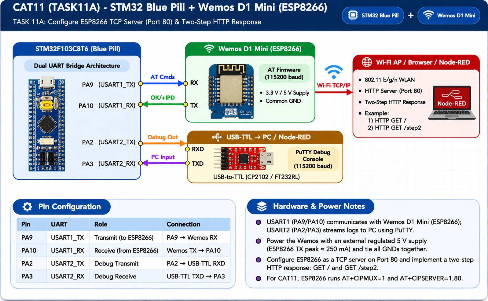

# CAT11 — Task 11A: ESP8266 TCP Server and HTTP Page

## EXP
CAT11 — 14/10/2026

## NAME OF EXP
Create a simple HTTP server using STM32 and the ESP8266 AT-command interface.

## HARDWARE SETUP / PLATFORM
STM32F103C8T6 Blue Pill, Wemos D1 Mini ESP8266, PC terminal for debug, web browser as client, STM32 HAL, Keil MDK-ARM. USART1 is the ESP modem link; USART2 is the PC logging link.

## TASK NO
Task 11A — start a TCP server on port 80 and return a basic HTML page to a browser.

## CIRCUIT DIAGRAM

## STEP-BY-STEP PROCEDURE
1. Wire STM32 USART1 TX/RX to Wemos RX/TX respectively and join the grounds.
2. Connect the PC terminal to the USART2 debug UART pins used by the board project.
3. Power the Wemos from a stable supply appropriate for the module.
4. Build and flash the STM32 project.
5. Open the debug terminal at the UART rate configured in the source (115200 baud, 8-N-1).
6. Reset the board. Firmware sends AT, AT+CIPMUX=1, and AT+CIPSERVER=1,80 to enable multi-connection mode and start a TCP server on port 80.
7. Connect the ESP8266 to a Wi-Fi access point using the network setup already available for the module. Obtain its IP address from the modem/network.
8. On a device on the same LAN, open a browser and enter http:// followed by the ESP8266 IP address.
9. The ESP8266 reports incoming client data to STM32 with a +IPD notification. Firmware extracts the link ID.
10. STM32 builds an HTTP/1.1 200 OK response containing a small HTML page, calculates Content-Length, sends AT+CIPSEND for that link, transmits the response, and closes the link.
11. Refresh the browser and inspect the returned page.

## HOW THE CODE WORKS
The receive loop looks for +IPD, parses the connection ID, creates the HTML body, wraps it in an HTTP response with content type and exact body length, sends it with AT+CIPSEND, then closes the client connection using AT+CIPCLOSE.

## EXPECTED OBSERVATION
The browser should display a page containing the STM32 IoT Node heading and “Hello from STM32” when the modem is connected and the request is parsed successfully.

## TROUBLESHOOTING
No browser connection: verify both devices are on the same LAN, the ESP IP is correct, server startup commands returned successfully, and port 80 is reachable. Malformed page: check Content-Length and ensure the CIPSEND length matches the transmitted response bytes. If the modem is not connected to Wi-Fi, complete the station join procedure first.

## INFERENCE
This task demonstrates a small embedded HTTP server implemented by combining STM32 application logic with ESP8266 TCP/IP modem commands.
