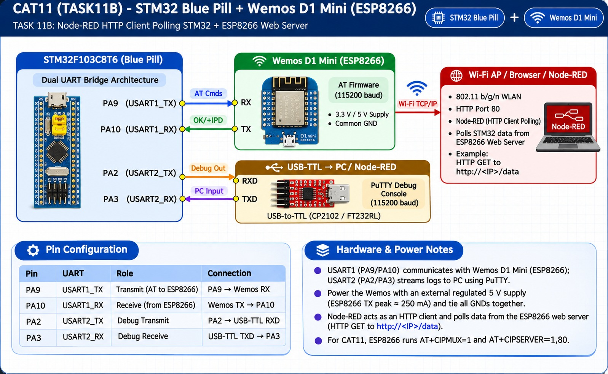

# CAT11 — Task 11B: Node-RED HTTP Client

## EXP
CAT11

## DATE
14/10/2026

## NAME OF EXP
Node-RED as an HTTP client for the STM32/ESP8266 HTTP server.

## HARDWARE SETUP / PLATFORM
- STM32F103C8T6 and Wemos D1 Mini (ESP8266)
- STM32CubeMX and Keil MDK-ARM
- Node-RED HTTP Request and Debug nodes
- Supporting flow: node_red_flow.json

## TASK NO
Task 11B — use Node-RED to send HTTP requests to the ESP8266-hosted server.

## CIRCUIT DIAGRAM

## CORE LOGIC / PSEUDOCODE / CODE BASE
1. Start the ESP8266 TCP server on port 80.
2. Receive HTTP GET requests from a client.
3. Prepare the response payload in the firmware and return it with HTTP headers.
4. Import node_red_flow.json into Node-RED.
5. Configure the HTTP Request node to call the ESP8266 server address and route the response to a Debug node.

Set the target IP address to the address assigned to the ESP8266 on the local network.

## INFERENCE
The task demonstrates a Node-RED HTTP client workflow communicating with an embedded HTTP endpoint. This describes the configured flow and firmware approach without asserting a live end-to-end test result.
