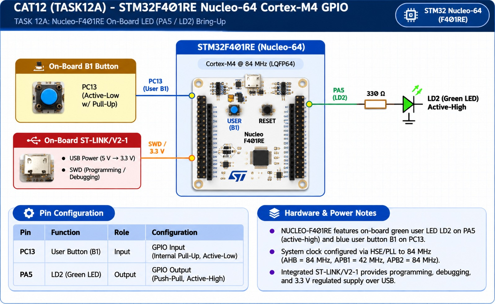

# CAT12 — Task 12A: Nucleo-F401RE LED Bring-Up

## EXP
CAT12 — 23/10/2026

## NAME OF EXP
Configure an STM32F401RE GPIO output and blink the onboard green LED.

## HARDWARE SETUP / PLATFORM
STM32 Nucleo-F401RE (STM32F401RET6), onboard LD2 LED on PA5, STM32CubeMX, Keil MDK-ARM, STM32 HAL.

## TASK NO
Task 12A — verify basic board programming and GPIO output by toggling LD2.

## CIRCUIT DIAGRAM

## STEP-BY-STEP PROCEDURE
1. Connect the Nucleo-F401RE to the computer through its ST-LINK USB connector.
2. Open the task's CubeMX .ioc file and confirm the target is STM32F401RET6 and PA5 is configured as a GPIO output.
3. Open the Keil project in MDK-ARM.
4. Build the project and resolve any missing STM32F4 device-pack or HAL dependencies.
5. Download the firmware through ST-LINK.
6. Reset the board.
7. Observe the green LD2 LED. The main loop toggles PA5 and calls HAL_Delay(500).
8. If the LED does not blink, check ST-LINK connection, target selection, PA5 mode, and successful programming.

## HOW THE CODE WORKS
HAL_Init() starts the HAL tick. SystemClock_Config() configures the MCU clock. MX_GPIO_Init() enables GPIOA and configures PA5 as push-pull output. The infinite loop calls HAL_GPIO_TogglePin(GPIOA, GPIO_PIN_5), then waits 500 ms.

## EXPECTED OBSERVATION
LD2 changes state every 500 ms, producing an approximate one-second full ON/OFF cycle.

## TROUBLESHOOTING
Confirm that the correct Nucleo target and project are selected, the ST-LINK is detected, and PA5 maps to LD2 on the board. If using another board, check its LED pin mapping.

## INFERENCE
This is the baseline STM32F4 bring-up task: clock, GPIO initialization, firmware download, and a periodic output.
