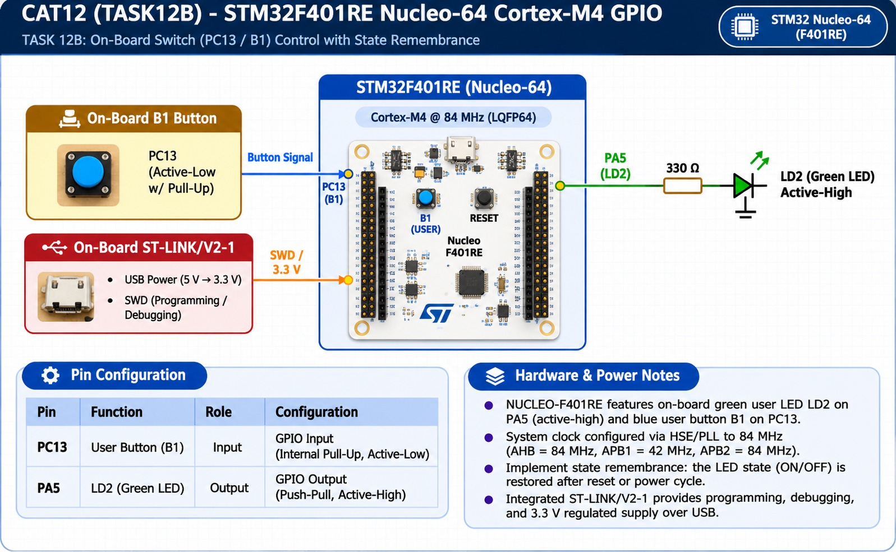

# CAT12 — Task 12B: Switch-Controlled LED State

## EXP
CAT12

## DATE
23/10/2026

## NAME OF EXP
Nucleo-F401RE user switch input with remembered LED state.

## HARDWARE SETUP / PLATFORM
- STM32 Nucleo-F401RE
- On-board LED LD2 on PA5
- User button B1 on PC13
- STM32CubeMX and Keil MDK-ARM

## TASK NO
Task 12B — detect a button press and toggle the LED state so it remains after the button is released.

## CIRCUIT DIAGRAM

## CORE LOGIC / PSEUDOCODE / CODE BASE
1. Read the user button input on PC13.
2. Detect a valid press transition and apply the debounce handling in the application.
3. Invert the stored LED state.
4. Write the stored state to PA5.
5. Continue monitoring the button.

## INFERENCE
The task demonstrates switch input processing and state retention for GPIO output control. The source implements the state-based approach; no independent hardware test result is asserted here.
