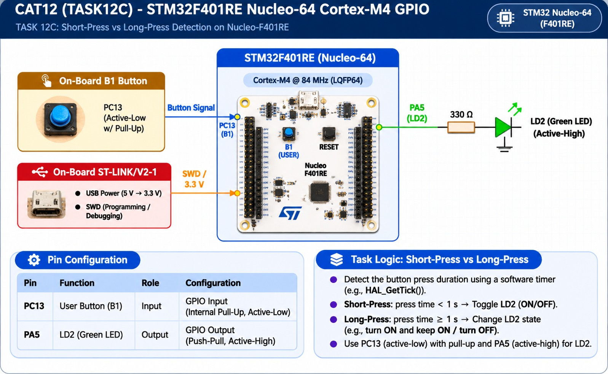

# CAT12 — Task 12C: Short-Press and Long-Press Detection

## EXP
CAT12

## DATE
23/10/2026

## NAME OF EXP
Short-press and long-press classification using the Nucleo-F401RE user button.

## HARDWARE SETUP / PLATFORM
- STM32 Nucleo-F401RE
- User button PC13
- On-board LED PA5
- STM32CubeMX and Keil MDK-ARM

## TASK NO
Task 12C — classify button press duration and apply the corresponding LED behavior.

## CIRCUIT DIAGRAM

## CORE LOGIC / PSEUDOCODE / CODE BASE
1. Record the tick count when a button press is detected.
2. Detect the button release.
3. Calculate the elapsed press duration using the HAL tick counter.
4. Classify the press as short or long using the threshold implemented in the source.
5. Apply the corresponding LED behavior without blocking the main application loop.

## INFERENCE
The task demonstrates time-based input classification using the STM32 HAL tick counter. Refer to the task source for the configured timing threshold and LED state behavior.
