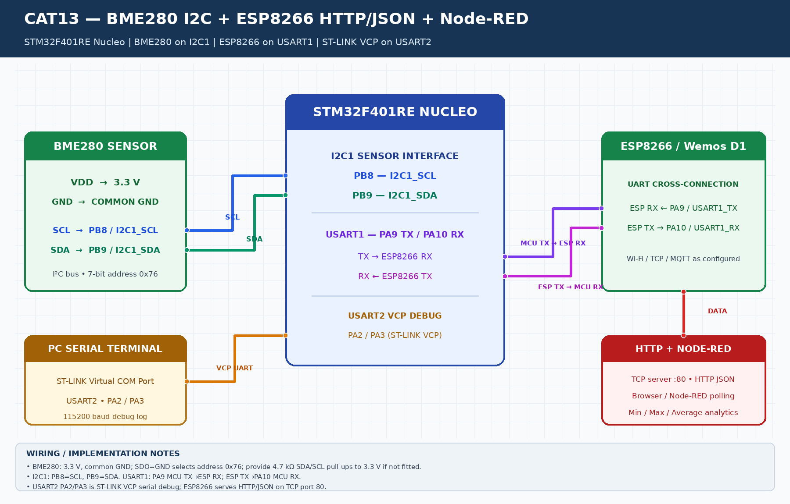

# CAT13 — BME280 Sensor over I2C and HTTP

## EXP
CAT13 — 27/10/2026

## NAME OF EXP
Read environmental measurements from a BME280 using STM32 I2C and expose the readings through an ESP8266 HTTP endpoint for Node-RED analytics.

## HARDWARE SETUP / PLATFORM
STM32 Nucleo-F401RE, BME280 sensor, Wemos D1 Mini/ESP8266, STM32CubeMX, Keil MDK-ARM, Bosch BME280 Sensor API, Node-RED. The source uses I2C1 and UART interfaces; verify the actual pin mapping in the task .ioc file and circuit image before wiring.

## TASK NO
CAT13 — initialize BME280, read compensated temperature/pressure/humidity, format JSON, and serve it over HTTP through ESP8266.

## CIRCUIT DIAGRAM

## STEP-BY-STEP PROCEDURE
1. Connect the BME280 to the STM32 I2C bus using the pin assignment shown by the task .ioc and circuit diagram. Connect sensor VCC to the supported 3.3 V rail and share GND.
2. Check the BME280 address. The source selects the primary address 0x76; confirm the sensor's SDO strap matches this address.
3. Connect ESP8266 UART TX/RX to the UART pins configured in the .ioc, crossing TX to RX and joining grounds.
4. Connect a separate serial terminal to the debug UART if the circuit uses one.
5. Open the CubeMX project and confirm I2C1, USART1, and USART2 configuration.
6. Open the Keil project and confirm the Bosch API source files (bme280.c, bme280.h, bme280_defs.h) are included in the build.
7. Build and flash the firmware.
8. On startup, the program attaches HAL-based I2C read/write callbacks and a delay callback to the Bosch driver, then calls bme280_init().
9. It configures temperature, pressure, and humidity oversampling to 1x, disables the filter, and selects normal mode.
10. The STM32 sends AT+CIPMUX=1 and AT+CIPSERVER=1,80 to configure the ESP8266 server.
11. Observe the debug UART for compensated temperature, pressure in hPa, and relative humidity.
12. Connect the ESP8266 to Wi-Fi using the network setup for the module. Open the returned endpoint from a browser or configure the Node-RED HTTP Request node to query it.
13. Import the Node-RED flow if provided, set the HTTP endpoint to the ESP8266 IP address, deploy, and inspect the JSON response and dashboard nodes.

## HOW THE CODE WORKS
The Bosch driver calls user_i2c_read() and user_i2c_write(), which use HAL_I2C_Mem_Read/Write. bme280_get_sensor_data() obtains compensated measurements. The firmware creates a JSON body, calculates its byte length, adds HTTP headers including Content-Length, and sends the response through ESP8266 using AT+CIPSEND after receiving a client notification.

## EXPECTED OBSERVATION
The debug terminal should show temperature, pressure, and humidity values. A browser/Node-RED HTTP client should receive a JSON response when the Wi-Fi server path is operating correctly.

## TROUBLESHOOTING
If BME280 initialization fails, verify 3.3 V, GND, SDA/SCL, address 0x76/0x77, and I2C pin mapping. If UART output is absent, check baud and TX/RX. If the HTTP client cannot connect, check ESP Wi-Fi association, IP address, server start response, and request parsing.

## INFERENCE
The experiment combines sensor-driver integration, I2C acquisition, UART modem control, JSON serialization, and HTTP-based IoT data access.
