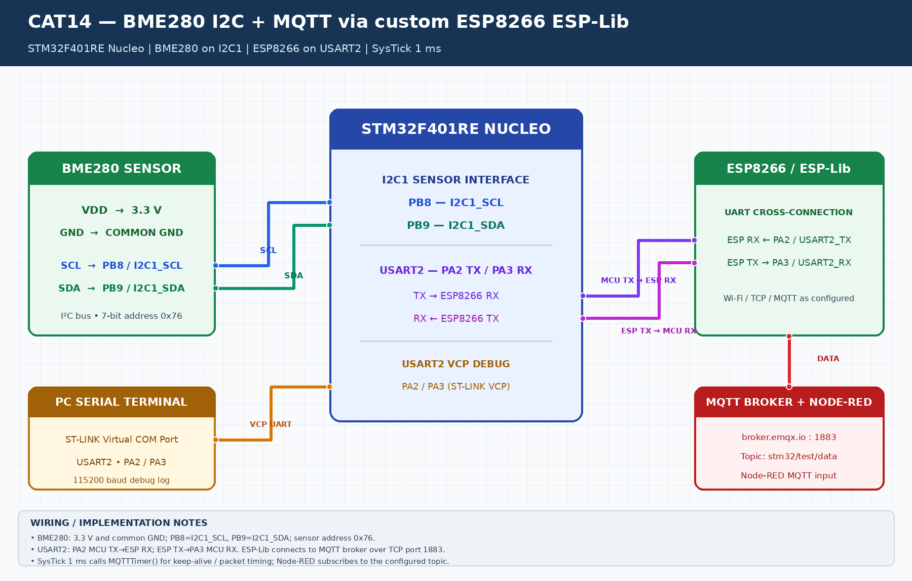

# CAT14 — BME280 Telemetry over MQTT

## EXP
CAT14 — 27/10/2026

## NAME OF EXP
Read BME280 environmental data on STM32 and publish telemetry to an MQTT broker using a custom ESP8266 library.

## HARDWARE SETUP / PLATFORM
STM32 Nucleo-F401RE, BME280, ESP8266, Bosch BME280 Sensor API, custom ESPLib, STM32 HAL, Keil MDK-ARM, public EMQX broker, Node-RED. The code uses I2C1 for the sensor and USART2 for the ESP8266 library.

## TASK NO
CAT14 — publish temperature, pressure, and humidity as JSON over MQTT and consume the messages in Node-RED.

## CIRCUIT DIAGRAM

## STEP-BY-STEP PROCEDURE
1. Wire BME280 to the I2C pins defined in the CubeMX project and the circuit diagram. The source uses the primary BME280 address 0x76; verify the SDO address strap.
2. Connect the ESP8266 UART interface to the USART2 pins used by the project and connect grounds.
3. Provide a stable supply for the ESP8266 and the sensor; verify logic-level compatibility.
4. Open the CubeMX .ioc file and confirm I2C1 and USART2 pin assignments.
5. Open the Keil project and verify that Bosch BME280 API and ESPLib source/header files are included.
6. Build and flash the STM32.
7. In main.c, replace example Wi-Fi credentials with your own local network credentials. Never commit a real password to a public repository.
8. Reset the board. Firmware initializes BME280 through the Bosch API callbacks, configures 1x oversampling and normal mode, initializes the ESP8266 in station mode, joins Wi-Fi, and opens a TCP connection to broker.emqx.io on port 1883.
9. The application configures an MQTT client ID and sends an MQTT CONNECT packet.
10. Read the JSON topic and broker settings from the source before configuring Node-RED. The CAT14 firmware publishes to stm32/test/data with QoS 0.
11. In Node-RED, add/configure an MQTT broker connection for broker.emqx.io:1883 and an MQTT-in node subscribed to stm32/test/data.
12. Connect the MQTT-in node to Debug or dashboard nodes, deploy, and inspect incoming JSON.
13. Compare the displayed temperature, humidity, and pressure fields with the serial/debug output from the sensor node.

## HOW THE CODE WORKS
The Bosch driver uses user_i2c_read(), user_i2c_write(), and user_delay_us() callbacks to communicate over HAL I2C. The firmware obtains compensated measurements, formats them as JSON, and calls MQTT_publishTopic() with the selected topic and QoS0. ESPLib handles ESP8266 AT transport and MQTT packet operations. MQTTDataHandler() processes received MQTT data in the application loop.

## IMPORTANT SOURCE CHECK
The source declares a short mqttTopic array but later uses a longer topic string literal for publishing. Review buffer sizes and topic handling before extending the application. The example Wi-Fi credentials are placeholders and must be replaced locally.

## EXPECTED OBSERVATION
Node-RED should receive JSON MQTT messages on the configured topic when Wi-Fi association, TCP broker connection, MQTT CONNECT, and publish operations all succeed.

## TROUBLESHOOTING
Sensor not detected: check I2C wiring, address and supply. ESP fails to join: check 2.4 GHz network, credentials and power. Broker unavailable: verify internet access and broker port 1883. No Node-RED messages: ensure exact topic match, broker configuration and MQTT node deployment.

## INFERENCE
The task demonstrates a complete IoT telemetry path: sensor acquisition, MCU processing, Wi-Fi transport, MQTT publish/subscribe, and Node-RED visualization.
