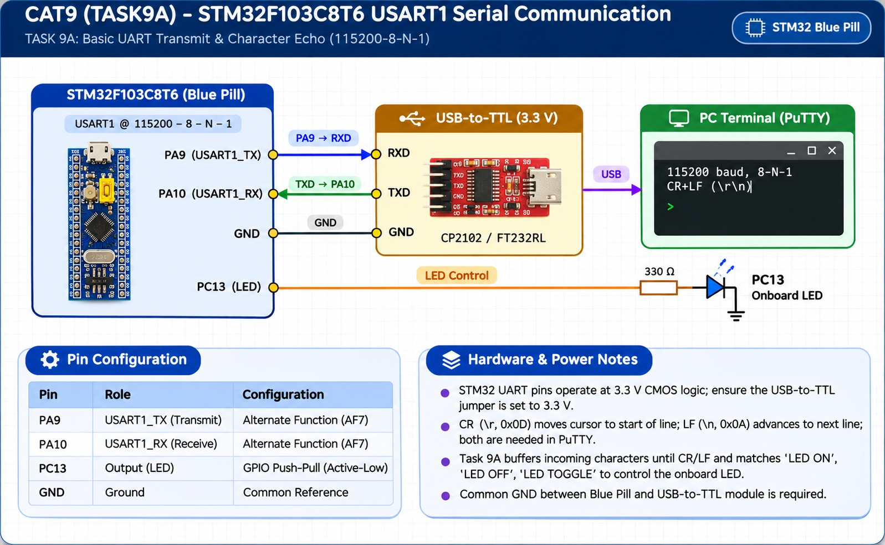

# CAT9 — Task 9A: UART Character Echo

## EXP / DATE
CAT9 — 28/09/2026

## NAME OF EXP
Configure STM32 UART communication and echo received characters to a PC terminal.

## HARDWARE SETUP / PLATFORM
STM32F103C8T6 Blue Pill, USB-to-TTL serial adapter, PC terminal, STM32CubeMX, Keil MDK-ARM and STM32 HAL. Source configures USART1 for 115200 baud, 8 data bits, no parity and one stop bit.

## TASK NO
Task 9A — transmit a startup banner and echo received bytes.

## CIRCUIT DIAGRAM

## STEP-BY-STEP PROCEDURE
1. Connect STM32 PA9 (USART1 TX) to adapter RXD.
2. Connect STM32 PA10 (USART1 RX) to adapter TXD.
3. Connect adapter GND to STM32 GND. Use a 3.3 V-compatible TTL UART adapter.
4. Open the TASK9A CubeMX project and confirm USART1 asynchronous mode.
5. Open MDK-ARM/TASK9A_UART_Echo.uvprojx in Keil.
6. Build the project and download it to the Blue Pill.
7. Open the serial terminal, select the adapter port and set 115200 baud, 8-N-1, no flow control.
8. Reset the board. The firmware sends HELLO and WORLD as separate lines using CR/LF.
9. Type characters in the terminal. The MCU receives one byte and transmits that same byte back.
10. If nothing appears, verify crossed TX/RX wiring, common ground, terminal baud rate and selected COM port.

## HOW THE CODE WORKS
HAL_Init(), SystemClock_Config(), GPIO initialization and USART initialization run first. HAL_UART_Transmit() sends the banner. In the main loop, HAL_UART_Receive() waits for one byte with a 50 ms timeout; on success, HAL_UART_Transmit() sends it back. CR returns the terminal cursor to the start of a line and LF advances to the next line.

## EXPECTED OBSERVATION
The terminal displays the startup banner and echoes each typed character.

## TROUBLESHOOTING
Garbled output: check baud rate and clock setup. No echo: check PA10/adapter TXD and PA9/adapter RXD. Use TTL UART, not an RS-232 voltage interface.

## INFERENCE
The task demonstrates UART initialization, byte reception, transmission and terminal communication.
