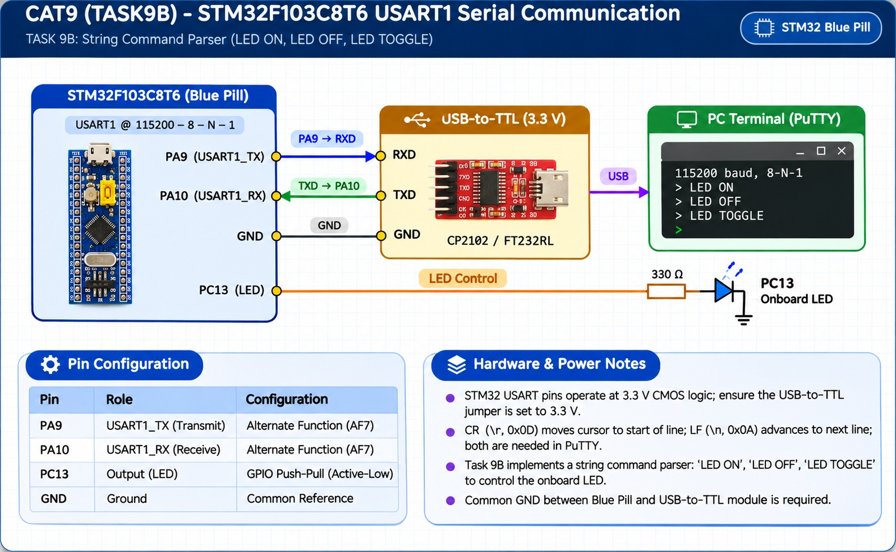

# CAT9 — Task 9B: UART String Commands for LED Control

## EXP / DATE
CAT9 — 28/09/2026

## NAME OF EXP
Receive text commands over UART and control the STM32 onboard LED.

## HARDWARE SETUP / PLATFORM
STM32F103C8T6 Blue Pill, USB-to-TTL adapter on USART1 PA9/PA10, PC terminal, STM32 HAL and Keil MDK-ARM. UART is configured at 115200 baud, 8-N-1. The application controls the onboard LED on PC13.

## TASK NO
Task 9B — accept LED ON, LED OFF and LED TOGGLE commands.

## CIRCUIT DIAGRAM

## STEP-BY-STEP PROCEDURE
1. Connect PA9 TX to adapter RX, PA10 RX to adapter TX and GND to GND.
2. Use a 3.3 V-compatible UART adapter.
3. Open TASK9B_UART_Cmd_LED.ioc or the Keil project and confirm USART1 and GPIO configuration.
4. Build and download the firmware.
5. Open the terminal at 115200 baud, 8 data bits, no parity, one stop bit and no flow control.
6. Reset the board and wait for the prompt listing the accepted commands.
7. Type LED ON and press Enter. The source writes PC13 RESET, the active-low ON state for the Blue Pill onboard LED.
8. Type LED OFF and press Enter. The source writes PC13 SET.
9. Type LED TOGGLE and press Enter. The source inverts the PC13 output.
10. Try an unsupported command and observe the Unknown command response.
11. Enter commands in uppercase and without extra spaces because strcmp() performs exact string matching.

## HOW THE CODE WORKS
Incoming bytes are appended to cmd_buf until CR or LF arrives. The firmware null-terminates the buffer and compares it with the three command strings using strcmp(). It performs the corresponding GPIO operation, transmits a response and resets cmd_idx for the next command.

## EXPECTED OBSERVATION
The onboard LED responds to the three supported commands and the terminal displays a confirmation prompt.

## TROUBLESHOOTING
Remember PC13 LED polarity is active-low. If commands are ignored, check capitalization, trailing spaces, Enter key behavior, UART wiring, baud rate and command buffer length.

## INFERENCE
The task demonstrates command framing, string comparison and UART-based actuator control.
